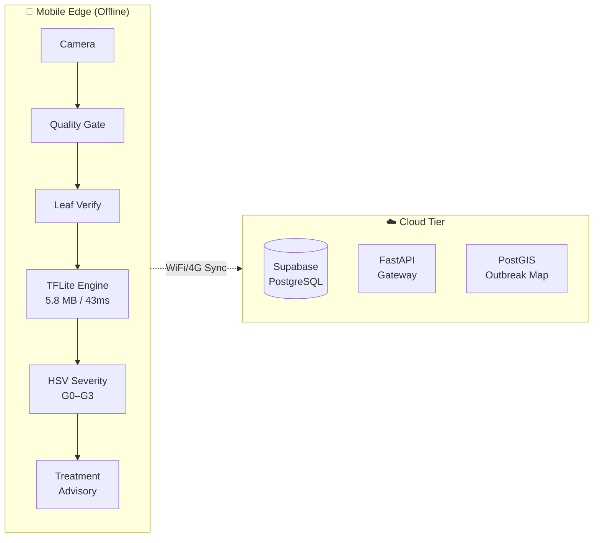

<div align="center">

# 🌾 CropVision

### Real-Time Edge-Native Crop Disease Detection with Severity Grading & Agronomic Advisory

[](LICENSE)
[](https://www.python.org/)
[](https://flutter.dev/)
[](https://pytorch.org/)
[](https://supabase.com/)
[](CONTRIBUTING.md)
[](https://conventionalcommits.org)

**54,305 images · 14 crops · 38 classes · 98.56% accuracy · 5.8 MB model · 43ms inference**

[📖 Documentation](#documentation) · [🚀 Quick Start](#quick-start) · [📊 Results](#model-performance) · [🤝 Contributing](CONTRIBUTING.md) · [📋 Changelog](CHANGELOG.md)

</div>

---

## 📋 Overview

**CropVision** is an end-to-end, edge-native agricultural intelligence framework that enables real-time crop disease detection on mobile devices — completely offline, without internet connectivity. It combines validation-first pre-processing, lightweight Vision Transformers, biological hierarchical classification, and HSV-based lesion severity grading.

### Key Capabilities

| Feature | Description |
|---------|-------------|
| 🔍 **Image Verification** | On-device blur detection & leaf/non-leaf validation gates |
| 🧠 **Disease Classification** | MobileViT-Small with 38-class pathology identification |
| 📊 **Severity Grading** | HSV-based lesion area quantification (G0–G3 stages) |
| 💊 **Treatment Advisory** | FRAC-coded fungicide/bactericide + organic bio-control prescriptions |
| 📱 **Offline Inference** | PTQ INT8 quantized to 5.8 MB, runs at 43ms on budget phones |
| 🌍 **10 Languages** | Hindi, Bengali, Telugu, Tamil, Marathi, Gujarati, Punjabi, Spanish, Swahili |
| ☁️ **Cloud Telemetry** | PostGIS spatial outbreak tracking with Row-Level Security |

---

## 🏗️ Architecture

```
Image Capture → Quality Gate (blur/exposure) → Leaf Verification Gate (HSV)
    → Disease Classification (MobileViT-Small) → Severity Grading (G0–G3)
    → Treatment Recommendation → Diagnosis History + Cloud Sync
```

### System Framework



---

## 📂 Project Structure

```
CropVision/
├── model/                          # 🧠 Python + PyTorch ML pipeline
│   ├── architectures/              #    Model architectures (MobileViT-V2, EfficientNet, etc.)
│   ├── benchmarks/                 #    Performance benchmarking tools
│   ├── explainability/             #    GradCAM & Integrated Gradients
│   ├── quantization/               #    PTQ INT8 pipeline & exporters
│   ├── tests/                      #    pytest suite (53+ tests)
│   ├── train_cropvision.py         #    Primary training script
│   ├── train_mobilevit.py          #    MobileViT-Small fine-tuning
│   ├── evaluate_test.py            #    Held-out test evaluation
│   ├── image_verification.py       #    Quality + leaf validation gates
│   ├── severity_estimation.py      #    HSV-based G0–G3 grading
│   ├── treatment_recommendations.py #   FRAC treatment mapping
│   ├── pipeline.py                 #    End-to-end inference pipeline
│   ├── inference_server.py         #    FastAPI REST server
│   └── requirements.txt
│
├── mobile_app/                     # 📱 Flutter cross-platform app
│   ├── lib/
│   │   ├── blocs/                  #    BLoC state management
│   │   ├── screens/                #    UI screens (auth, capture, home, etc.)
│   │   ├── services/               #    Backend & inference services
│   │   ├── models/                 #    Data models
│   │   ├── widgets/                #    Reusable UI components
│   │   ├── l10n/                   #    Localization (10 languages)
│   │   └── theme/                  #    App theming
│   └── pubspec.yaml
│
├── backend/                        # ☁️ Supabase backend
│   ├── services/                   #    12 enterprise services
│   ├── database/                   #    Migration schemas
│   ├── edge-functions/             #    Serverless functions
│   ├── tests/                      #    Backend test suites
│   ├── supabase_schema.sql         #    Core schema with RLS
│   ├── seed_crops.sql              #    Crop seed data
│   └── seed_treatment_guidelines.sql
│
├── docs/                           # 📖 Documentation
│   ├── agronomy/                   #    Field guides & treatment protocols
│   ├── api/                        #    OpenAPI 3.1 specification
│   ├── architecture/               #    System design & RFC documents
│   ├── models/                     #    Model cards & evaluation protocol
│   └── research_figures/           #    Publication-quality figures
│
├── .github/                        # ⚙️ GitHub configuration
│   ├── workflows/                  #    CI/CD pipelines
│   ├── ISSUE_TEMPLATE/             #    Bug, feature, crop support templates
│   └── pull_request_template.md
│
├── CROPVISION_PROJECT_DOCUMENTATION.md  # Full research paper
├── MODEL_DOCUMENTATION.md          # Model & pipeline documentation
├── CONTRIBUTING.md                 # Contribution guidelines
├── CHANGELOG.md                    # Version history
├── CODE_OF_CONDUCT.md              # Community standards
├── SECURITY.md                     # Security policy
├── LICENSE                         # MIT License
└── .env.example                    # Environment variable template
```

---

## 🚀 Quick Start

### Prerequisites

| Tool | Version | Purpose |
|------|---------|---------|
| Python | ≥ 3.10 | ML pipeline |
| PyTorch | ≥ 2.0 | Model training & inference |
| Flutter | ≥ 3.19 | Mobile application |
| Supabase | — | Backend-as-a-Service |

### 1. Clone the Repository

```bash
git clone https://github.com/CropVision-Team/Crop_Vision.git
cd Crop_Vision
```

### 2. Python / ML Pipeline Setup

```bash
cd model
python -m venv venv

# Windows:
venv\Scripts\activate
# macOS/Linux:
source venv/bin/activate

pip install -r requirements.txt
```

Verify GPU availability (optional but recommended):
```bash
python -c "import torch; print(f'CUDA: {torch.cuda.is_available()}')"
```

### 3. Flutter Mobile App Setup

```bash
cd mobile_app
flutter pub get
flutter doctor     # Check platform tooling
flutter analyze    # Verify code health
flutter run        # Launch on device/emulator
```

> **Configuration**: Pass your Supabase credentials at runtime:
> ```bash
> flutter run --dart-define=SUPABASE_URL=https://xxx.supabase.co --dart-define=SUPABASE_ANON_KEY=xxx
> ```

### 4. Supabase Backend Setup

1. Create a project at [supabase.com](https://supabase.com)
2. Run SQL files in **SQL Editor** (in order):
   ```
   1. backend/supabase_schema.sql
   2. backend/seed_crops.sql
   3. backend/seed_treatment_guidelines.sql
   ```
3. Copy `.env.example` → `.env` and add your API keys
4. Enable Email/Password authentication in **Authentication → Providers**

### 5. Run Tests

```bash
# ML pipeline tests
cd model
pip install pytest
python -m pytest tests/ -v

# Dataset integrity audit
python audit_dataset.py --train_dir ./dataset --test_dir ./official_test
```

---

## 📊 Model Performance

### Benchmarked Architectures

| Model | Test Accuracy | Macro-F1 | ECE | Top-5 Acc | Params | Size (INT8) |
|-------|:------------:|:--------:|:---:|:---------:|:------:|:-----------:|
| **MobileViT-Small** ⭐ | **98.56%** | **0.9810** | 0.022 | 99.92% | 5.6M | **5.8 MB** |
| DE-HVT | 98.38% | 0.9798 | 0.025 | 99.88% | 6.1M | 6.2 MB |
| XCiT-Nano-12 | 97.95% | 0.9765 | 0.028 | 99.85% | 3.1M | 3.4 MB |
| DeiT-Tiny/16 | 97.74% | 0.9742 | 0.031 | 99.81% | 5.7M | 5.9 MB |

### Per-Crop Test Accuracy (MobileViT-Small)

| Crop | Accuracy | Classes |
|------|:--------:|:-------:|
| Blueberry | 99.69% | 1 |
| Soybean | 99.69% | 1 |
| Pepper Bell | 99.55% | 2 |
| Squash | 99.47% | 1 |
| Orange | 99.39% | 1 |
| Raspberry | 99.38% | 1 |
| Potato | 99.26% | 3 |
| Cherry | 99.12% | 2 |
| Strawberry | 98.93% | 2 |
| Apple | 98.85% | 4 |
| Peach | 98.53% | 2 |
| Grape | 98.68% | 4 |
| Tomato | 98.24% | 10 |
| Corn (Maize) | 98.11% | 4 |

### Severity Grading (G0–G3)

| Stage | Diseased Area | Interpretation |
|-------|:------------:|----------------|
| **G0** | 0–2% | Healthy — no intervention needed |
| **G1** | 2–15% | Mild — organic protectants recommended |
| **G2** | 15–40% | Moderate — targeted chemical treatment |
| **G3** | 40–100% | Critical — emergency eradication required |

---

## 📖 Documentation

| Document | Description |
|----------|-------------|
| [Project Documentation](CROPVISION_PROJECT_DOCUMENTATION.md) | Full research paper with methodology, results, and analysis |
| [Model Documentation](MODEL_DOCUMENTATION.md) | Architecture, training, severity grading, and known limitations |
| [Evaluation Protocol](docs/models/evaluation_protocol.md) | Safety checks and field-test protocol for accuracy claims |
| [Model Cards](docs/models/model_cards.md) | Comprehensive model cards with calibration curves |
| [System Architecture](docs/architecture/system_architecture_spec.md) | RFC-0042: Edge-to-cloud topology specification |
| [API Specification](docs/api/) | OpenAPI 3.1 spec for CropVision cloud API |
| [Agronomy Field Guide](docs/agronomy/) | Clinical treatment protocols for 50+ plant conditions |
| [Contributing Guide](CONTRIBUTING.md) | How to contribute to CropVision |
| [Changelog](CHANGELOG.md) | Complete version history |

---

## 🧪 Model-Evaluation Safety Checks

Before presenting accuracy results, run the duplicate/source audit and follow
the field-test protocol:

```bash
cd model
python audit_dataset.py --train_dir ./dataset --test_dir ./official_test
```

See [docs/models/evaluation_protocol.md](docs/models/evaluation_protocol.md) for the complete protocol.

---

## 🏋️ Training

### Download Dataset

```bash
pip install datasets
python -c "
from datasets import load_dataset
ds = load_dataset('mohanty/PlantVillage', 'color')
ds['train'].save_to_disk('./plantvillage_raw')
"
```

### Train MobileViT-Small

```bash
cd model
# Quick validation (2-3 epochs):
python train_mobilevit.py --data_dir ./dataset --epochs 3

# Full training run:
python train_mobilevit.py --data_dir ./dataset --epochs 40
```

---

## 🔌 Supported Crops & Diseases

<details>
<summary><b>14 Crops · 38 Classes</b> (click to expand)</summary>

| Crop | Disease Classes |
|------|-----------------|
| **Apple** (4) | Scab, Black Rot, Cedar Rust, Healthy |
| **Blueberry** (1) | Healthy |
| **Cherry** (2) | Powdery Mildew, Healthy |
| **Corn** (4) | Cercospora Leaf Spot, Common Rust, Northern Leaf Blight, Healthy |
| **Grape** (4) | Black Rot, Esca (Black Measles), Leaf Blight (Isariopsis), Healthy |
| **Orange** (1) | Huanglongbing (Citrus Greening) |
| **Peach** (2) | Bacterial Spot, Healthy |
| **Pepper Bell** (2) | Bacterial Spot, Healthy |
| **Potato** (3) | Early Blight, Late Blight, Healthy |
| **Raspberry** (1) | Healthy |
| **Soybean** (1) | Healthy |
| **Squash** (1) | Powdery Mildew |
| **Strawberry** (2) | Leaf Scorch, Healthy |
| **Tomato** (10) | Bacterial Spot, Early Blight, Late Blight, Leaf Mold, Septoria Leaf Spot, Spider Mites, Target Spot, Yellow Leaf Curl Virus, Mosaic Virus, Healthy |

</details>

---

## ⚠️ Known Placeholders

| File | Placeholder | Replace With |
|------|-------------|--------------|
| `mobile_app/lib/main.dart` | `YOUR_PROJECT` / `YOUR_ANON_KEY` | Real Supabase credentials |
| `mobile_app/lib/services/inference_service.dart` | Hardcoded 38 classes | Real TFLite model inference |
| `mobile_app/lib/screens/capture/capture_screen.dart` | Demo diagnosis | Real pipeline integration |
| `mobile_app/lib/screens/assistant_screen.dart` | Placeholder reply | Supabase Edge Function + LLM |
| `model/severity_estimation.py` | `SEVERITY_THRESHOLDS` | Tune against real photos per crop |

---

## 🤝 Contributing

We welcome contributions! Please read our [Contributing Guide](CONTRIBUTING.md) and [Code of Conduct](CODE_OF_CONDUCT.md) before getting started.

```bash
# Fork → Clone → Branch → Code → Test → PR
git checkout -b feat/your-feature
# Make changes...
python -m pytest model/tests/ -v
git commit -m "feat(model): add your feature"
git push origin feat/your-feature
# Open a Pull Request!
```

---

## 📄 License

This project is licensed under the [MIT License](LICENSE).

---

## 🙏 Acknowledgments

- [PlantVillage Dataset](https://github.com/spMohanty/PlantVillage-Dataset) — Foundation image corpus
- [timm](https://github.com/huggingface/pytorch-image-models) — PyTorch Image Models library
- [Supabase](https://supabase.com) — Backend-as-a-Service platform
- [Flutter](https://flutter.dev) — Cross-platform mobile framework

---

<div align="center">

**CropVision** — Making crop disease detection accessible to every farmer 🌾

[⬆ Back to Top](#-cropvision)

</div>
